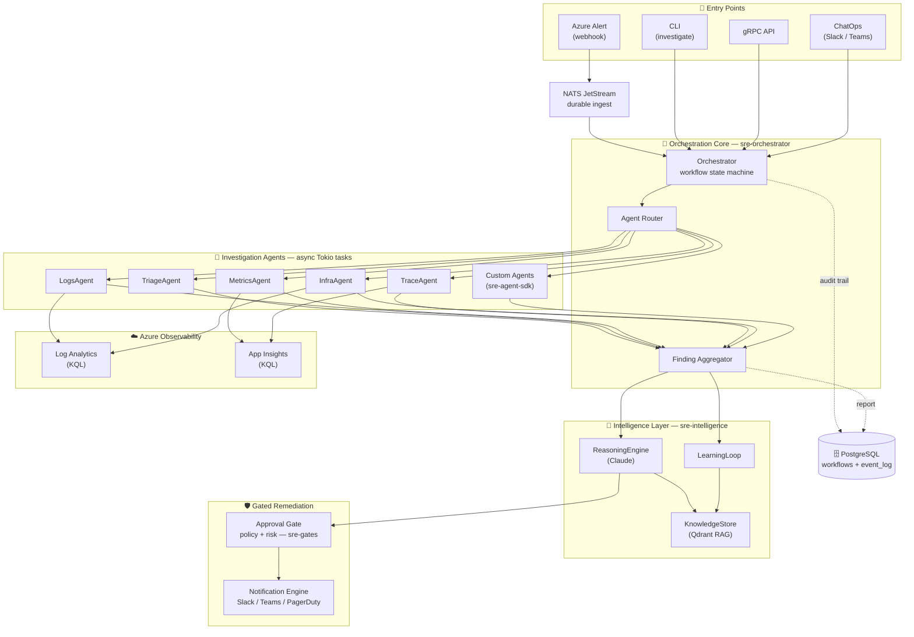
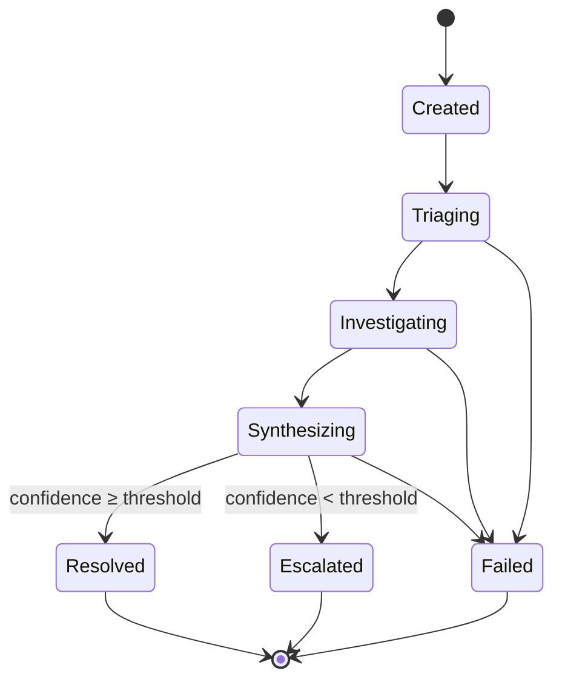

# SRE AI Agents Platform

[](https://github.com/dimon2255/sre-ai-agents/actions/workflows/ci.yml)
[](https://github.com/dimon2255/sre-ai-agents/actions/workflows/security.yml)
[](https://www.rust-lang.org)
[](#license)
[](#roadmap)

An AI-driven **Site Reliability Engineering** platform built in Rust. It uses an
**orchestrator + specialized sub-agents** pattern to automate incident
investigation, alert triage, and root-cause analysis against **Azure Monitor**,
**Log Analytics**, and **Application Insights** — then layers LLM reasoning,
retrieval-augmented incident memory, and policy-gated remediation on top.

---

## Highlights

- **Orchestrator + sub-agents** — a single workflow engine fans investigations out to
  long-lived async agents over typed message channels (no shared mutable state).
- **Azure-native observability** — every query runs through parameterized, sanitized
  KQL templates; no freeform query construction (ADR-005).
- **Intelligent root-cause analysis** — findings are synthesized by a pluggable
  reasoning engine (Claude) and grounded by a vector memory of past incidents.
- **Safe-by-default remediation** — a pure-policy approval gate re-derives risk and
  routes high-risk actions to human approval; Phase 1 agents are strictly read-only.
- **Multiple entry points** — Azure Alert webhooks, a CLI, a gRPC API, and a
  Slack/Teams ChatOps interface all drive the same engine.
- **Extensible** — third parties add agents via the lightweight `sre-agent-sdk` crate
  without depending on the platform internals.
- **Measured, not assumed** — a golden-set evaluation scores whether investigations
  reach the right answer, and a CI ratchet blocks quality regressions (ADR-023).

---

## Evaluation

Unit tests show each component behaves as coded. They do not show whether an
investigation reaches the right answer. The golden-set evaluation
([`crates/evals`](crates/evals)) replays 14 hand-labeled incidents through the
production orchestrator and all five agents, replacing only the Azure query
endpoint with fixture telemetry. It scores each report against ground truth.

Baseline, 2026-10-11, rule-based pipeline:

| Outcome | Result |
|---|---|
| Report leads with the true root cause | 29% (4 of 14) |
| True root cause found somewhere in the findings | 75% (9 of 12) |
| Signal detection precision / recall | 92% / 88% |
| Correct escalation decision (missed pages) | 93% (1 missed page) |
| First remediation proposal acceptable | 50% (7 of 14) |
| Claude root-cause analysis judged correct (LLM tier, 3 runs) | 71% (10 of 14) in every run |

The platform usually finds the evidence but ranks symptoms above causes: an error
spike from a bad deploy outranks the deploy. Claude's analysis of the same
findings names the true cause far more often, but remediation proposals and
paging still come from the rule-based ranking. The
[baseline report](docs/evals/golden-set-report.md) traces every miss to a specific
code path and proposes fixes; the [scorecard](docs/evals/scorecard.md) has
per-scenario detail. Design and limits are in
[ADR-023](docs/adr/023-golden-set-evaluation.md).

```bash
cargo run -p sre-evals                         # run the golden set, write the scorecard
cargo test -p sre-evals                        # CI gate: fails if any passing check regresses
ANTHROPIC_API_KEY=... cargo run -p sre-evals -- --engine claude   # also grade the Claude RCA with an LLM judge
```

How it scores:

- **Contrastive pairs.** Most scenarios come in pairs with the same symptom and a
  different cause: a deploy against a stuck instance, a hard dependency failure
  against a graceful fallback, an alert on noise against a traffic blackhole.
  Pattern-matching on symptoms cannot pass both halves.
- **Order-independent.** Agents reply asynchronously. A tie at the top of the
  ranking is scored as a miss rather than a coin flip, so scores are identical
  run to run.
- **Ratchet gate.** `baseline.json` records which checks pass per scenario. CI
  fails if any of them regresses; improvements are locked in with
  `--write-baseline`.

---

## Architecture



The orchestrator coordinates specialized agents that run as async Tokio tasks,
communicating via typed message channels (ADR-003, ADR-006). Each agent queries
Azure observability APIs through parameterized KQL templates and returns
structured findings with confidence scores. The aggregator hands the merged
findings to the intelligence layer for root-cause synthesis, and any proposed
remediation passes through the approval gate before execution.

### Investigation lifecycle

Every investigation is a validated state machine — transitions are checked by
`WorkflowState::can_transition_to()`, and escalation fires automatically when the
aggregated confidence falls below the configured threshold.



---

## Workspace Structure

The platform is a Cargo workspace of focused crates. Inter-crate communication
types live in `sre-common`; every layer follows the same **trait + mock + real
binding** shape so the whole system runs deterministically in CI without Azure,
Postgres, or an LLM.

| Crate | Responsibility |
|-------|----------------|
| **`sre-common`** | Shared types: `AgentMessage` envelope, `AlertInfo`, `Finding`, `InvestigationReport`, `PlatformConfig`, remediation types, error hierarchy. |
| **`sre-azure`** | Azure API layer: `TokenProvider` auth trait, `AzureQueryClient` (KQL over REST), `AzureAlertsClient` (Common Alert Schema), parameterized KQL templates. |
| **`sre-store`** | Persistence: `WorkflowStore` + `EventLog` traits with a `PgStore` (PostgreSQL via `sqlx`) backend and a migration-bootstrapped audit trail. |
| **`sre-agents`** | `SreAgent` trait + the five built-in investigation agents (`TriageAgent`, `LogsAgent`, `MetricsAgent`, `TraceAgent`, `InfraAgent`) and the propose-only `RemediationAgent`. |
| **`sre-agent-sdk`** | Stable, lightweight surface for building **custom** investigation agents (depends only on `sre-common`) — see ADR-019. |
| **`sre-orchestrator`** | Investigation engine: workflow state machine, `AgentRouter`, `FindingAggregator`, per-investigation reply channels, timeouts. |
| **`sre-intelligence`** | Phase 3: `ReasoningEngine` (Claude), `KnowledgeStore` (Qdrant RAG of past incidents), and a `LearningLoop` that feeds outcomes back in. |
| **`sre-gates`** | Pure-policy approval gate (ADR-009): re-derives risk and routes remediation to auto-execute, single, or dual human approval. |
| **`sre-notify`** | Notification engine: severity-gated fan-out to Slack / Teams / PagerDuty. |
| **`sre-chatops`** | Transport-agnostic ChatOps command parser + handler (Slack/Teams), ADR-018. |
| **`sre-evals`** | Golden-set evaluation of investigation quality: labeled incidents, fixture KQL server, scorer, CI ratchet, optional LLM judge (ADR-023). |
| **root crate** | CLI entrypoint (clap), webhook server (axum), gRPC API, and bootstrap wiring. |

---

## Quick Start

Requirements: Rust 1.94 or newer, `protoc` (for the gRPC API), and Docker. The
test suite starts its own Postgres and NATS containers; `serve` and
`investigate` need a running Postgres, which `docker-compose.yml` provides on
`localhost:5432` with the credentials in `config/default.toml`. If 5432 is taken,
start it with `SRE_PG_PORT=55432` and set `SRE__STORE__DATABASE_URL` to match.

```bash
# Build the whole workspace
cargo build --workspace

# Run the test suite (unit + integration; Docker required for store tests)
cargo test --workspace

# Local Postgres for the commands below
docker compose up -d --wait

# Lint & format
cargo clippy --workspace
cargo fmt --all -- --check

# Manual investigation (uses mock auth unless Azure credentials are configured)
cargo run -- investigate --resource my-app --severity Sev1

# Start the webhook server (Azure Alert ingestion, port 8080)
cargo run -- serve
```

Set `RUST_LOG` to control tracing output
(default: `info,sre_orchestrator=debug,sre_agents=debug`).

---

## Configuration

Configuration is loaded from `config/default.toml` and can be overridden with
`SRE__`-prefixed environment variables (e.g. `SRE__AZURE__SUBSCRIPTION_ID`).

```toml
[azure]
auth_mode        = "mock"                       # "mock" (dev/CI) | "azure"
subscription_id  = "your-subscription-id"
workspace_ids    = ["your-log-analytics-workspace-id"]
app_insights_ids = ["your-app-insights-app-id"]

[orchestrator]
agent_timeout_secs            = 30
max_concurrent_investigations = 10
```

With `auth_mode = "mock"` (as set in `config/default.toml`; a config that omits
the key gets `"azure"`) the Azure clients present a fixed dummy
token (`MockTokenProvider`), so no real Azure data is read. With
`auth_mode = "azure"`, `AzureCredentialProvider` (`crates/azure/src/auth.rs`)
currently returns a pre-issued bearer token read from the `AZURE_ACCESS_TOKEN`
environment variable, unchanged for every scope and never refreshed. That is
enough for manual testing against one API audience (for example a token from
`az account get-access-token --resource https://api.loganalytics.io`), not for a
deployment. Wiring `azure_identity` (`DefaultAzureCredential`: managed identity in
Azure, Azure CLI locally) with per-scope tokens and refresh is a listed
follow-up and a go-live blocker in [docs/PROGRESS.md](docs/PROGRESS.md).

LLM reasoning activates when `ANTHROPIC_API_KEY` is set and
the reasoning engine is enabled in config; otherwise a deterministic mock engine
is used.

---

## Roadmap

| Phase | Focus | Status |
|-------|-------|--------|
| **Phase 1** | Read-only investigation (Log Analytics + App Insights) | ✅ Complete |
| **Phase 2** | Gated remediation, approval gates, ChatOps, notifications, NATS ingest | ✅ Functionally complete (mock end-to-end) |
| **Phase 3** | LLM reasoning, knowledge store + learning loop, progressive-trust auto-remediation, Agent SDK, multi-workspace | ✅ Code-complete — exit criteria evaluation-gated |

Workspace line coverage: **83%** (82.89% of 8,823 lines; `cargo llvm-cov --workspace`
with the Docker-backed suites, measured 2026-10-12). The badge is static, so
re-measure and update it when coverage moves.

See [docs/PROGRESS.md](docs/PROGRESS.md) for detailed tracking and
[docs/adr/](docs/adr/) for the 22 architecture decision records that document
the platform's design.

---

## License

Released under the **MIT License**.
