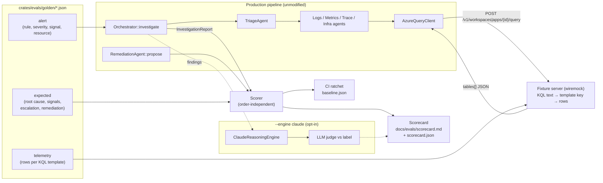

# Golden-Set Evaluation Harness — Data Flow

See [ADR-023](../adr/023-golden-set-evaluation.md).

## What is real and what is replaced

| Component | In the eval | Why |
|---|---|---|
| Orchestrator, workflow, aggregator | Real | These decide ranking and escalation, the behavior under test. |
| Triage, logs, metrics, trace, infra agents | Real | Thresholds and finding categories are under test. |
| `AzureQueryClient` (HTTP, auth header, parsing) | Real | Exercises the same request and response path as production. |
| Azure Log Analytics / App Insights endpoints | Replaced by fixture server | Hand-authored rows per scenario, shaped like real query results, make runs reproducible and free. |
| Workflow store and event log | In-memory | Persistence is not under test and needs no Docker. |
| Remediation proposer | Real (`propose` only) | Measures what would be proposed. Nothing executes. |
| Reasoning engine | Off by default; Claude when `--engine claude` | The LLM tier is optional and not deterministic. |
